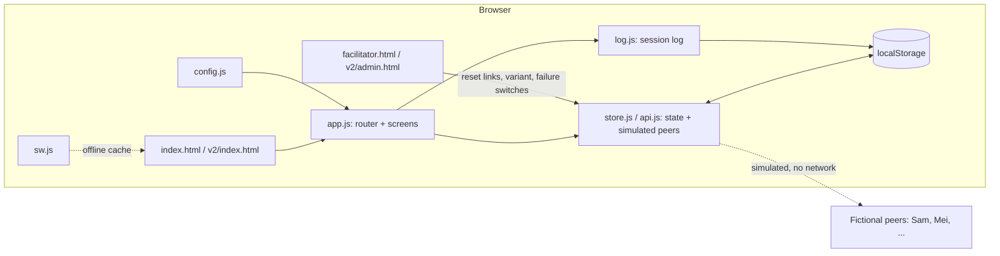

# UniLend (prototype)

A clickable, offline-capable mobile web prototype for peer-to-peer lending of small items (chargers, calculators, adapters) between students, built to run a moderated usability test.

> **Status: course prototype (HCI / interaction design), not a production app.** Everything is static HTML/CSS/vanilla JS. There is no real backend, no real accounts and no real data. All people, items and places are fictional.

## Problem and context

Students often need something for an hour (a phone charger before a lab, a calculator before a quiz) that another student nearby has unused in a bag. UniLend explores one design question: *can students complete borrow, return and lend tasks quickly and without hints, and does a non-monetary "Pass-It-On" reward loop feel natural?*

This was built as group coursework for a university interaction-design and testing course. The need itself is the team's assumption and was not measured. The test plan, two report variants and the data-collection sheet are kept in [`docs/`](docs/).

## What it does (as implemented)

**v1 - usability-test prototype** (`/`, `index.html`, `js/`)
- Scripted flows for three test tasks: borrow an item, return an item, lend an item and use the reward. Screens: sign-in (simulated email code), browse and search with categories, item detail, request with pickup spot, accept / decline, simulated QR hand-off and return, "scan failed" recovery, "item no longer available" recovery, loans list, Pass-It-On chain, rewards and claim, community leaderboard, profile and list-an-item form.
- Two reward variants selectable in `js/config.js` (`recognition` or `perks`) for an A/B design comparison; simulated peer response delay and scan feedback delay are configurable.
- Session logger (`js/log.js`): records taps, screens, backtracks, recovery states per task run in `localStorage` only, to support the note-taker.
- Facilitator page (`facilitator.html`): per-task "reset and start" links, variant switch and failure switches (first scan fails, item unavailable, request refused).
- Dark mode, service worker for offline use (network first, cache fallback), web manifest and icon set, and a page documenting the (AI-made) brand graphics (`assets.html`).

**v2 - extended preview** (`/v2/`)
- Tabbed feed / activity / rewards / profile app with item listing, request flow, chat, avatar picker and rewards, using ES modules and a `localStorage` state store (`v2/js/data/api.js`).
- Admin page (`v2/admin.html`) with scenario templates for instant reset, a "Wizard-of-Oz" partner console, role display and study configuration / export.
- Client-side sign-in (`v2/js/data/auth.js`): SHA-256 with a salt via the Web Crypto API, role-based UI for `student` / `facilitator` / `admin`, 24-hour session token, `@algomau.ca` email domain check.
- A Firebase web config file is present but **Firebase is not actually used**: `initFirebase()` only logs a message. State lives in the browser.

## Screenshots

<!-- TODO: add screenshots under docs/screenshots/ and link them here -->
| Home / browse | Request and pickup spot | QR hand-off | Rewards |
|---|---|---|---|
| _TODO_ | _TODO_ | _TODO_ | _TODO_ |

<!-- TODO: add a 20-30 second screen recording / GIF of Task 1 (borrow a charger) -->

## Tech stack

| Area | Choice |
|---|---|
| UI | Hand-written HTML, CSS (custom properties, dark mode), vanilla JavaScript (IIFE modules in v1, ES modules in v2) |
| State | In-memory store + `localStorage` (no server) |
| Offline | Service worker (`sw.js`), Web App Manifest |
| Crypto (v2 demo auth) | Web Crypto API (SHA-256) |
| Assets | Hand-authored SVG avatars, items, zones, rewards, illustrations |
| Hosting | Any static host (GitHub Pages `.nojekyll` is included) |
| Build tooling | None |

## Architecture



## Repository structure

```
index.html, js/, css/, sw.js   v1 test prototype (served at /)
facilitator.html               facilitator controls for v1
assets.html, assets/           brand and graphic assets (all fictional / AI-made)
v2/                            extended preview (feed, chat, admin, demo auth)
docs/                          test plan, data sheet, report PDFs, recruitment text, video plan
```

## How to run

Requires only Python 3 (or any static file server). Verified: every page below returns HTTP 200.

```bash
git clone https://github.com/henish73/unilend-prototype.git
cd unilend-prototype
python -m http.server 5180
```

Then open:
- v1 prototype: http://localhost:5180/
- Facilitator tools: http://localhost:5180/facilitator.html
- v2 preview: http://localhost:5180/v2/ (admin: `/v2/admin.html`)
- Documents: http://localhost:5180/docs/

Demo sign-in for v2 is shown on its login screen (all accounts are fictional; there is no real security, see Limitations). v1 sign-in accepts any `@algomau.ca`-style address and the on-screen demo code.

## Data

There is no dataset. Seed content is hand-written fictional data in `js/data.js` and `v2/js/data/scenarios.js`. `docs/UniLend_P2_Data_Sheet.csv` is an empty template for recording usability-test observations (task outcome, time, errors, hints, ease rating, severity). No participant data is included.

## Limitations (honest)

- It is a prototype: no backend, no multi-user sync, no payments, no real QR scanning (hand-offs are simulated with a timed delay).
- v2 "authentication" is entirely client-side: salted hashes and a public demo credential list in the shipped JavaScript, and any `@algomau.ca` address can self-register with any password. It demonstrates a UI/RBAC concept only and must not be reused as a security design.
- The Firebase config in `v2/js/firebase-config.js` is a development project's web config; it is not wired to anything. Web API keys are not secrets, but Firebase security rules and key restrictions should be set if it is ever connected.
- The usability study described in `docs/` has not produced results in this repo (the data sheet is blank).
- No automated tests, no CI, no accessibility audit yet.
- The service worker header mentions a `tools/stamp_version.py` release script that is not in this repository.

## Roadmap

See the improvement plan for what would make this portfolio-grade (real backend, auth, tests, accessibility, published study results). Short version: build a small real backend, add tests and CI, publish anonymised study findings.

## Skills demonstrated

Interaction and UX design, user-research planning (task design, A/B variants, facilitator tooling), frontend engineering without frameworks (routing, state, ES modules), offline PWA basics, accessibility-minded mobile UI (touch targets, dark mode), basic client-side crypto API usage, and writing/communicating a test protocol.

## License

MIT (code). See [LICENSE](LICENSE). The documents in `docs/` are group coursework; reuse the code, not the report text.
